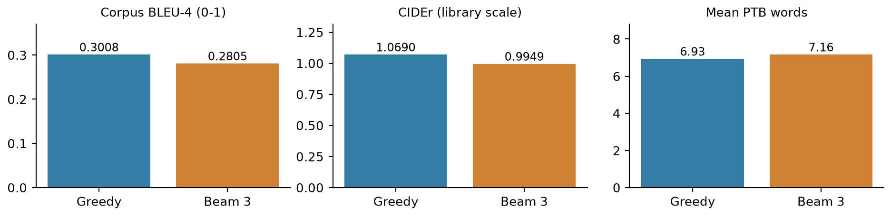
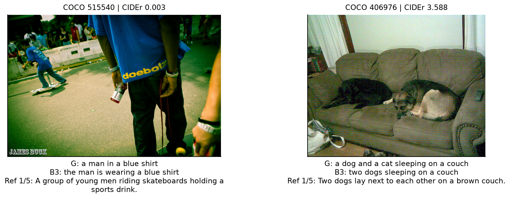
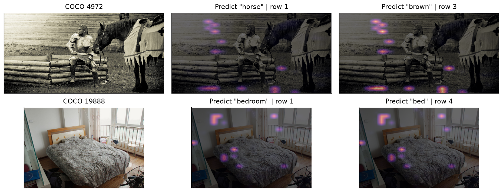
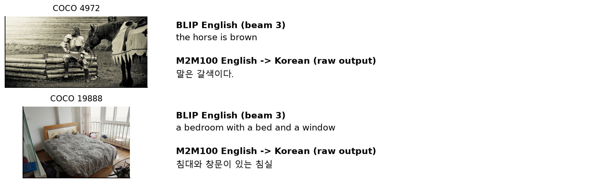

# BLIP 이미지 캡셔닝과 한국어 번역

사진을 영어 문장으로 설명하고 한국어로 번역하는 12주차 이미지 캡셔닝 실습이다. BLIP의 ViT 이미지 인코더와 자기회귀 텍스트 디코더를 사용해 Greedy와 Beam Search 3을 비교하고, 실제 디코더 교차 Attention을 추출했다. 추가 학습이나 가중치 업데이트는 없다.

실제로 추론한 COCO 사진 100장에서 **Greedy의 BLEU-4 0.3008·CIDEr 1.0690**, **Beam 3의 BLEU-4 0.2805·CIDEr 0.9949**를 얻었다. 이 표본에서는 후보 수를 늘리는 것이 두 지표를 높이지 않았다. 한국어는 영어 캡션을 M2M100으로 번역한 결과이며, 번역기는 사진을 입력받지 않는다.

## 실제 실행 환경과 모델

2026-11-24에 **Apple M4 GPU, Metal/MPS, float32, batch 8, seed 42**로 실행했다. Colab CLI의 T4·L4 생성 요청이 지연되어 로컬 GPU로 진행했으며, 여기의 수치는 Colab에서 측정한 결과가 아니다. 아래 Colab 노트북은 CUDA 재실행용이며 이번 작업에서 실행 검증한 환경은 MPS다. GPU나 패키지가 달라지면 출력과 시간도 달라질 수 있다.

| 항목 | 실제 설정 |
|---|---|
| Python | 3.12.14 |
| PyTorch / torchvision | 2.15.0 / 0.29.2 |
| Transformers | 4.57.1 |
| 캡셔닝 | [Salesforce/blip-image-captioning-base](https://huggingface.co/Salesforce/blip-image-captioning-base), BSD-3-Clause |
| BLIP revision | `82a37760796d32b1411fe092ab5d4e227313294b` |
| 번역 | [facebook/m2m100_418M](https://huggingface.co/facebook/m2m100_418M), MIT |
| M2M100 revision | `55c2e61bbf05dfb8d7abccdc3fae6fc8512fd636` |
| 입력 | RGB, bicubic 384×384, 모델 프로세서 정규화, 텍스트 접두어 없음 |
| 학습 | 두 모델 모두 eval, gradient update 0 |

BLIP의 실제 로드된 고유 파라미터 수는 223,971,644개다. M2M100의 모델 이름은 418M이지만 이 체크포인트를 라이브러리에서 로드해 센 수는 483,905,536개다. 저장된 전체 환경과 전처리는 [environment.json](results/environment.json), 모델과 생성 설정은 [protocol.json](results/protocol.json)에 있다. 인증 토큰 없이 공개 모델을 다운로드했다.

## 데이터와 평가 범위

[BLIP 작성자의 COCO Karpathy test 목록](https://storage.googleapis.com/sfr-vision-language-research/datasets/coco_karpathy_test.json)을 COCO val2014 메타데이터와 결합했다. 알려진 작성자 train·val 목록과 겹치지 않고 COCO 라이선스 ID 4, CC BY 2.0인 이미지 중 영어 참조가 5개 이상인 후보는 823장이다. 정렬된 ID에서 Python `random.Random(42).sample(..., 100)`을 적용하고 다시 정렬했다. 각 사진에는 annotation ID 순서의 첫 영어 참조 5개를 썼다.

이미지 100장만 다운로드했으며 총 17,229,605바이트다. 이미지 ID, 출처, Flickr 링크, 라이선스, 참조 문장, 이미지·원본 메타데이터 SHA-256은 [data/manifest.json](data/manifest.json)에 있다. 원본 사진 전체는 저장소에 포함하지 않는다. COCO 주석은 COCO Consortium의 CC BY 4.0이며 사진 저작권은 각 사진 저작자에게 있다. 그림에 사용한 네 사진의 제목·저작자·변경 사항은 [THIRD_PARTY_NOTICES.md](THIRD_PARTY_NOTICES.md)에 명시했다.

알려진 train 및 val 중복은 모두 0장이다. 웹 사전학습 자료까지 중복이 없다고 확인한 것은 아니다. 라이선스로 제한한 100장·한 seed의 작은 표본이므로 전체 5,000장 테스트나 다른 상품군·언어의 성능으로 일반화하지 않는다.

## 디코딩과 실제 결과

공통 설정은 `max_new_tokens=30`, `min_new_tokens=3`, `do_sample=False`, `length_penalty=1.0`, `repetition_penalty=1.0`, `no_repeat_ngram_size=0`이다. Greedy는 `num_beams=1`, Beam 3은 `num_beams=3, early_stopping=True`다. 두 조건과 주 분석 조건 Beam 3은 추론 전에 정했으며 테스트 점수로 조정하지 않았다.

| 같은 사진 100장, 영어 참조 각 5개 | Greedy | Beam 3 |
|---|---:|---:|
| 코퍼스 BLEU-4, 0–1 | 0.300787 | 0.280526 |
| CIDEr, 라이브러리 척도 | 1.069019 | 0.994862 |
| 평균 PTB 단어 수 | 6.93 | 7.16 |
| 100장 생성 루프, 초 | 11.32 | 20.60 |

시간은 한 번의 루프 측정이며 GPU 동기화 후 측정했다. 이미지 읽기·전처리·생성·디코딩을 포함하고 설치·다운로드·모델 로딩·사전 워밍업·Attention·평가를 제외한다. 두 조건을 Greedy→Beam 3 순서로 실행했다. 반복 측정이나 순서 무작위화가 없어 정밀한 속도 벤치마크로 해석하지 않는다. MPS 실행이므로 CUDA 최대 메모리 수치는 null이다.

캡션이 72장 바뀌었고 이미지별 CIDEr는 Beam 3에서 33장 상승·39장 하락·28장 동일했다. 두 조건은 같은 사진의 쌍으로, 독립 사진 200장을 평가한 것이 아니다. 이는 학습 전후 비교가 아니다.





위 사진은 Beam 3의 이미지별 CIDEr를 점수와 ID로 정렬한 뒤 0·99번째를 고른 사후 설명 사례다. 대표 무작위 표본이 아니다. 낮은 사례는 파란 셔츠를 설명하지만 스케이트보드와 행동을 생략했다. 높은 사례에서는 Greedy의 `a dog and a cat`이 Beam 3에서 `two dogs`로 바뀌었다. 사진과 참조를 함께 보아야 하며 자연스러운 문장이 사실성을 보장하지 않는다.

### 평가와 독립 재계산

`pycocoevalcap==1.2`의 Stanford PTBTokenizer, Bleu(4), Cider를 사용했다. BLEU-4는 1~4그램의 clipped modified precision, 가장 가까운 참조 길이에 대한 brevity penalty, 코퍼스 기하평균이다. 이미지별 BLEU-4를 평균한 수치가 아니다.

CIDEr는 해당 구현의 TF-IDF 유사도·클리핑·Gaussian 길이 벌점 sigma 6·×10 척도를 그대로 썼다. 이 구현에는 CIDEr-D 방식의 클리핑과 길이 벌점이 있다. 문서 빈도와 IDF도 **같은 100장 참조 그룹**에서 추정했다. 따라서 전체 테스트의 공식 수치와 직접 비교하지 않는다.

[verify_results.py](experiments/verify_results.py)는 라이브러리 점수 함수를 호출하지 않고 PTB 토큰화 증거에서 BLEU 및 CIDEr 계산을 독립적으로 구현해 재계산한다. 두 조건의 코퍼스·이미지별 수치가 허용오차 1e-9에서 일치했다. 데이터·Attention·번역 검증과 결과 해시는 [verification.json](results/verification.json)에 기록했다. 원래 라이브러리 소스는 복제하지 않고 패키지 의존성으로 사용한다.

## 실제 교차 Attention



사전에 정한 첫 네 ID 4972·19888·21198·23117에서 생성된 Beam 3 토큰을 다시 디코더에 입력했다. 이미지 인코더의 577토큰은 CLS 1개와 24×24패치다. 최종 디코더 층의 12개 헤드를 평균하고, 생성 시퀀스의 `j`번째 토큰을 예측하는 입력 행 `j-1`을 읽었다. 첫 사례의 별도 접두어 실행과 전체 teacher-forcing 실행의 같은 위치 logits 차이 최댓값은 0.0이었다.

그림에는 첫 두 사진에서 stopword를 제외한 첫 두 개의 서로 다른 완전한 WordPiece 단어를 표시했다. CLS 질량을 제외한 576패치의 합이 1이 되게 재정규화했고, 모든 패널에 동일한 색 범위 0–0.06798325를 적용했다. 밝을수록 패치 가중치가 크다. 원본은 늘이거나 자르지 않았고, 프로세서의 정사각 resize에 대응하도록 패치 격자를 원본 화면 크기로 표시했다. 마지막 층의 평균 가중치는 실제 물체 바깥에도 나타나므로 인과적 설명·세분화 마스크·정답 위치 확률로 해석할 수 없다.

[cross_attention.npz](results/cross_attention.npz)는 CLS를 포함한 원 가중치를 보존한다. [attention_records.json](results/attention_records.json)에는 토큰·행·헤드 수가, [selected_examples.json](results/selected_examples.json)에는 표시 선택 규칙이 있다.

## 한국어 번역



Beam 3 영어 캡션 100개를 M2M100에 `src_lang='en'`, `forced_bos_token_id=ko`, `num_beams=4`, `max_new_tokens=64`, `length_penalty=1.0`, 샘플링 없이 입력했다. 별도 번역 루프는 13.75초였다. 그림은 사전에 정한 첫 두 사진이며 한국어는 모델 원출력을 사람이 고쳐 쓰지 않았다.

말 사진의 영어 `the horse is brown`은 인물을 놓치고 세피아 사진에서 단정하기 어려운 색을 기술한다. 한국어 `말은 갈색이다.`도 이를 그대로 이어받는다. 침실 사진에서는 침대·창문을 설명했다. 번역은 출력 언어를 바꾸며 이미지 인식 오류를 자동 수정하지 않는다. 한국어 정답 캡션이나 별도 사람 평가가 없으므로 한국어 정확도·BLEU·만족도는 주장하지 않는다.

## 재현

[Colab GPU 노트북 열기](https://colab.research.google.com/github/choi0312/visionai-blip-captioning/blob/main/notebooks/colab_captioning.ipynb). GPU 런타임을 선택하고 셀을 순서대로 실행한다. 노트북은 이번에 실행한 MPS 결과를 CUDA에서 재실행하기 위한 경로이며, CUDA 실행 성공이나 동일 수치를 보증한 기록은 아니다. 작업 후 런타임 연결 해제와 삭제를 수행한다.

로컬에서는 Python 3.12, 실행 장치에 맞는 PyTorch/torchvision과 Java가 필요하다. 실제 MPS 실험은 PyTorch 2.15.0/torchvision 0.29.2였다. `pytorch_model.bin`을 읽으므로 PyTorch 2.6 이상을 사용한다. 평가에는 PTBTokenizer용 Java를 PATH에서 찾을 수 있어야 한다. 이 실험은 격리 환경의 `jdk4py==25.0.5.1` Java를 사용했다.

```bash
git clone https://github.com/choi0312/visionai-blip-captioning.git
cd visionai-blip-captioning
python -m pip install -r requirements.txt
export VISIONAI_ROOT="$PWD"
export VISIONAI_DEVICE=mps  # NVIDIA GPU에서는 cuda
export TOKENIZERS_PARALLELISM=false
export PYTORCH_ENABLE_MPS_FALLBACK=1
python experiments/download_images.py
python experiments/caption_inference.py
python experiments/evaluate_captions.py
python experiments/analyze_and_plot.py
python experiments/verify_results.py
```

MPS fallback을 허용한 실행이다. Apple GPU 실행을 기록했지만 모든 개별 연산의 CPU fallback 여부를 프로파일링하지는 않았다. CUDA 재실행에서는 해당 MPS 환경변수가 필요하지 않다. 다운로드/모델 캐시는 이미지 17MB 외에 수 GB가 추가로 필요하다. 모델은 공개 상태에서 인증 없이 실행했다.

재실행은 `results/`와 `figures/`의 저장 결과를 덮어쓴다. 원본 결과를 보존하려면 먼저 별도 복사한다. 샘플 선택부터 검증하려면 `download_images.py` 대신 `prepare_data.py`를 실행한다. 후자는 약 115MB의 원본 메타데이터도 다운로드한다. 그래프의 한국어는 로컬 Word의 맑은 고딕이 있으면 이를 사용하며, 없으면 Noto Sans CJK KR을 내려받아 그린다. 폰트 파일은 저장소에 포함하지 않았다.

## 저장 파일

- `experiments/`: 데이터 선택·다운로드, 추론, 평가, 원 Attention 추출, 시각화, 독립 재계산 코드.
- `notebooks/colab_captioning.ipynb`: CUDA GPU 재실행 안내.
- `data/manifest.json`: 샘플 100장과 참조·출처·분할·해시.
- `results/captions.json`: Greedy/Beam 3 영어 캡션·토큰과 M2M100 한국어 출력·토큰.
- `results/tokenized_evidence.json`, `per_image_metrics.json`, `metrics.json`: 토큰화 및 점수.
- `results/processor/`, `model_config.json`, `protocol.json`, `environment.json`: 재현 설정.
- `figures/`: 실제 사진과 결과에서 생성한 도표, 실제 모델 카드 화면, 명시적으로 편집한 코드 발췌.

제출 보고서·학번 등 개인정보, 입력 자료, 인증 정보와 비공개 작업 파일은 공개하지 않는다.

## 업무 적용과 한계

상품 설명·검색 태그·대체텍스트 초안에 활용할 수 있다. 사진만으로 확인할 수 없는 브랜드·재질·성능은 제품 DB로 보완하고 원문과 번역을 함께 검토한다. 도입 전 독립 표본에서 객체 오류·누락·수정률·작성 및 검수 시간·언어별 품질을 측정해야 한다. 짧은 문장과 참조 유사도가 실제 이용 목적에 필요한 정보를 충분히 담았다는 뜻은 아니다.

## 출처

- Li et al., [BLIP 논문](https://arxiv.org/abs/2201.12086), [Salesforce 공식 코드](https://github.com/salesforce/BLIP), [COCO 캡셔닝 설정](https://github.com/salesforce/BLIP/blob/main/configs/caption_coco.yaml).
- [BLIP 모델 카드](https://huggingface.co/Salesforce/blip-image-captioning-base), [Transformers 4.57.1 BLIP 문서](https://huggingface.co/docs/transformers/v4.57.1/en/model_doc/blip).
- [M2M100 모델 카드](https://huggingface.co/facebook/m2m100_418M), [Transformers M2M100 문서](https://huggingface.co/docs/transformers/v4.57.1/en/model_doc/m2m_100).
- [COCO](https://cocodataset.org/), [공식 이용 조건](https://cocodataset.org/#termsofuse), [COCO caption 평가 코드](https://github.com/tylin/coco-caption), [Python 3 평가 패키지](https://github.com/salaniz/pycocoevalcap).
- 이미지 원출처·CC 라이선스·모델/의존성 고지는 [THIRD_PARTY_NOTICES.md](THIRD_PARTY_NOTICES.md)와 [manifest](data/manifest.json)에 있다.

코드·시각화 작성에 GPT 6.1 Sol 모델을 활용했다.
